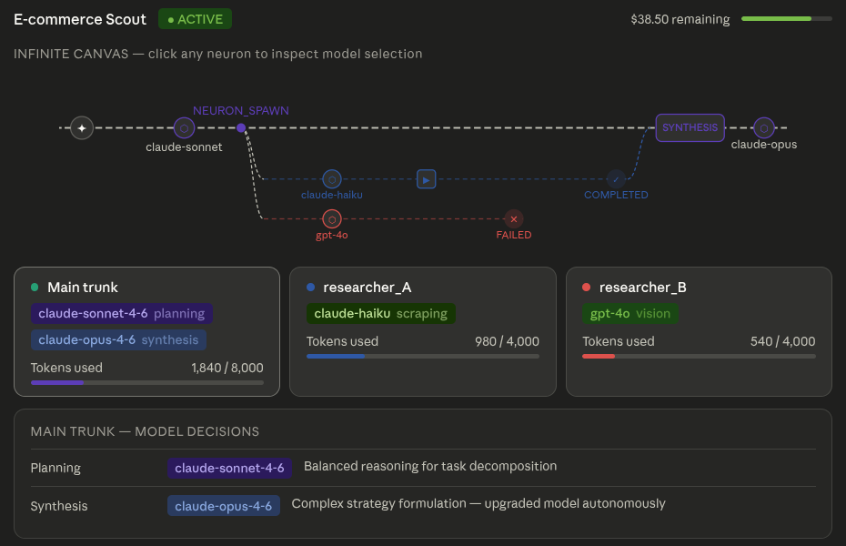

# Darwin — Per-Neuron LLM Model Selection

> **Feature spec v0.1** · Affects: `darwin-agent`, `darwin-backend`, `darwin-frontend`

---

## 1. Overview

Darwin agents can autonomously select a different LLM model for each cognitive moment — each `THOUGHT` event on the main trunk and each neuron they spawn. This decision is made at runtime by the agent itself, based on task complexity and metabolic cost. Every model choice is surfaced live on the Infinite Canvas so the human creator can observe the agent's cost-intelligence tradeoffs in real time.

### Canvas mockup



---

## 2. Motivation

A single model chosen at spawn time is metabolically wasteful. A repetitive web-scraping loop has no need for `claude-opus-4-6`; a final strategic synthesis has no business running on `claude-haiku`. By giving the agent the ability to route each cognitive call to the cheapest capable model, Darwin can dramatically lower its Basal Metabolic Rate on routine tasks while preserving high-intelligence headroom for genuine problem-solving.

This maps directly to the P&L Imperative: **every token burned must earn its cost**.

---

## 3. Agent-Side Changes (`darwin-agent`)

### 3.1 Model routing logic

The Hermes framework's system prompt (`SOUL.md`) should include a model routing policy. The agent consults this policy before each LLM call:

```markdown
## Model Routing Policy

Before every LLM call, select the cheapest model capable of the task:

| Task type                                     | Default model     |
| --------------------------------------------- | ----------------- |
| Repetitive extraction, simple classification  | claude-haiku-4-5  |
| General reasoning, planning, tool calls       | claude-sonnet-4-6 |
| Complex strategy, multi-step synthesis        | claude-opus-4-6   |
| Vision-heavy tasks (JS apps, complex UIs)     | gpt-4o            |
| Fast vision checks, screenshot classification | gpt-4o-mini       |

Always justify model upgrades in your THOUGHT content.
```

### 3.2 Neuron spawn payload

When spawning a neuron, the agent must include a `model` field in the `NEURON_SPAWNED` event payload. This becomes the neuron's default model for the duration of its life:

```python
# darwin-agent: spawning a researcher neuron
await emit_event("NEURON_SPAWNED", {
    "neuron_id": "researcher_A",
    "task": "Scrape competitor A pricing page",
    "parent_event_id": current_event_id,
    "model": "claude-haiku-4-5",           # <-- new field
    "model_reason": "Repetitive extraction — Haiku sufficient"  # <-- new field
})
```

### 3.3 THOUGHT event payload

Every `THOUGHT` already has a `model` field in the backend schema. The agent must populate it on every call — no exceptions:

```python
await emit_event("THOUGHT", {
    "content": "I will spawn 2 researcher neurons...",
    "model": "claude-sonnet-4-6",
    "prompt_tokens": 1280,
    "completion_tokens": 80,
    "latency_ms": 1100
})
```

---

## 4. Backend Changes (`darwin-backend`)

### 4.1 Schema — `NeuronSpawnedPayload`

Add `model` and `model_reason` to the existing Pydantic payload shape:

```python
# schemas/canvas.py

class NeuronSpawnedPayload(BaseModel):
    neuron_id: str
    task: str
    parent_event_id: str
    model: str                    # e.g. "claude-haiku-4-5"
    model_reason: str | None = None   # optional human-readable justification
```

### 4.2 Schema — `ThoughtPayload`

`model` already exists. No schema change needed — ensure it is always populated and never `null`:

```python
class ThoughtPayload(BaseModel):
    content: str
    model: str          # required — reject if absent
    prompt_tokens: int
    completion_tokens: int
    latency_ms: int
```

### 4.3 Validation

Add a check in the `/telemetry/stream-event` router: if `event_type` is `THOUGHT` and `payload.model` is absent or empty, return `422 Unprocessable Entity`. This enforces observability discipline on the agent.

```python
# routers/telemetry.py

if body.event_type == "THOUGHT":
    if not body.payload.get("model"):
        raise HTTPException(422, "THOUGHT event must include payload.model")
```

---

## 5. Frontend Changes (`darwin-frontend`)

### 5.1 Canvas node — `<ThoughtNode />`

Every `ThoughtNode` renders a model tag directly beneath the brain icon. Tag colour encodes the model family:

| Model family    | Tag class          | Colour                       |
| --------------- | ------------------ | ---------------------------- |
| `claude-opus`   | `model-opus`       | Blue (`border-sky-500`)      |
| `claude-sonnet` | `model-sonnet`     | Violet (`border-violet-500`) |
| `claude-haiku`  | `model-haiku`      | Green (`border-green-500`)   |
| `gpt-4o`        | `model-gpt4o`      | Teal (`border-teal-500`)     |
| `gpt-4o-mini`   | `model-gpt4o-mini` | Amber (`border-amber-500`)   |

```vue
<!-- components/canvas/ThoughtNode.vue -->
<template>
  <g :class="['node', 'thought-node']" @click="canvas.selectEvent(event.id)">
    <circle :cx="x" :cy="y" r="9" class="thought-circle" />
    <!-- brain icon glyph -->
    <text :x="x" :y="y + 3.5" text-anchor="middle" class="node-glyph">⬡</text>
    <!-- model tag below the node -->
    <foreignObject :x="x - 40" :y="y + 14" width="80" height="18">
      <span :class="['model-tag', modelClass]">{{ shortModel }}</span>
    </foreignObject>
  </g>
</template>

<script setup lang="ts">
const props = defineProps<{ event: DarwinEvent; x: number; y: number }>();
const canvas = useCanvasStore();

const shortModel = computed(() => {
  const m = props.event.payload.model ?? "";
  if (m.includes("opus")) return "opus";
  if (m.includes("sonnet")) return "sonnet";
  if (m.includes("haiku")) return "haiku";
  if (m.includes("4o-mini")) return "gpt-4o-mini";
  if (m.includes("4o")) return "gpt-4o";
  return m.split("-")[0];
});

const modelClass = computed(() => {
  if (shortModel.value === "opus") return "model-opus";
  if (shortModel.value === "sonnet") return "model-sonnet";
  if (shortModel.value === "haiku") return "model-haiku";
  if (shortModel.value === "gpt-4o") return "model-gpt4o";
  if (shortModel.value === "gpt-4o-mini") return "model-gpt4o-mini";
  return "model-unknown";
});
</script>
```

### 5.2 Neuron lane header — `<NeuralThread />`

The lane label at the branch point shows the neuron's spawn model. If the neuron uses a different model at any point during its life, a `↔` indicator appears after the label:

```vue
<!-- components/canvas/NeuralThread.vue — label section -->
<text :x="branchX + 88" :y="laneY - 10" class="lane-label">
  {{ lane.neuron_id }}
  <tspan class="model-tag-inline">{{ spawnModel }}</tspan>
  <tspan v-if="modelSwitched" class="model-switch-indicator"> ↔</tspan>
</text>
```

```typescript
const spawnModel = computed(() => {
  const spawnEvent = props.lane.events.find(
    (e) => e.event_type === "NEURON_SPAWNED",
  );
  return spawnEvent?.payload?.model ?? "—";
});

const modelSwitched = computed(() => {
  const models = props.lane.events
    .filter((e) => e.event_type === "THOUGHT")
    .map((e) => e.payload.model)
    .filter(Boolean);
  return new Set(models).size > 1;
});
```

### 5.3 Mental Replay panel — `<MentalReplayPanel />`

Add the model field to the existing MIND panel alongside tokens and cost. No layout changes needed — insert between the response content and the token stats:

```
┌──────────────────────────────────────────────────────┐
│ Mental Replay — "Thought" (14:32:07)          [✕]    │
├──────────────────┬───────────────────────────────────┤
│  EYES            │  MIND                             │
│                  │                                   │
│  [screenshot]    │  > Prompt: "You are..."           │
│                  │  > Response: "I cannot click..."  │
│                  │                                   │
│                  │  Model:   claude-sonnet-4-6       │  ← new
│                  │  Tokens:  1,280 in / 80 out       │
│                  │  Cost:    $0.0042                 │
│                  │  Latency: 1,100ms                 │
└──────────────────┴───────────────────────────────────┘
```

```vue
<!-- Inside MentalReplayPanel.vue — MIND section stats -->
<div class="stat-row">
  <span class="stat-label">Model</span>
  <span :class="['model-tag', modelClass(trace.model)]">{{ trace.model }}</span>
</div>
<div class="stat-row">
  <span class="stat-label">Tokens</span>
  <span>{{ trace.prompt_tokens.toLocaleString() }} in / {{ trace.completion_tokens.toLocaleString() }} out</span>
</div>
```

### 5.4 Neuron inspector cards

The neuron inspector panel (rendered below the canvas) shows a `model-tag` for each neuron's spawn model, and lists any mid-run model switches in the token breakdown:

```vue
<!-- components/panels/NeuronInspectorCard.vue -->
<div class="neuron-card" :class="{ selected: isSelected }">
  <div class="card-header">
    <span :class="['status-dot', lane.status]" />
    <span class="neuron-id">{{ lane.neuron_id }}</span>
    <span :class="['model-tag', modelClass(spawnModel)]">{{ spawnModel }}</span>
  </div>
  <div class="model-decisions" v-if="modelDecisions.length > 1">
    <span class="label">Model switches</span>
    <span v-for="d in modelDecisions" :key="d.event_id" :class="['model-tag', modelClass(d.model)]">
      {{ d.model }}
    </span>
  </div>
  <div class="token-bar">
    <div class="token-fill" :style="{ width: pctUsed + '%' }" />
  </div>
</div>
```

### 5.5 `<SpawnForm />` — step 1 update

The existing model selector (radio group in Step 1 — Identity) sets the **trunk default model**. Add a note making clear this is a default the agent can override:

```
LLM model (trunk default)
○ Claude Sonnet 4.6   — Balanced · recommended
○ Claude Haiku 4.5    — Fast · cheapest
○ Claude Opus 4.6     — Highest intelligence · most expensive
○ GPT-4o              — Best vision capabilities
○ GPT-4o Mini         — Fast vision · low cost

ℹ The agent may upgrade or downgrade this model autonomously
  per neuron or per thought based on task complexity.
```

---

## 6. Type changes (`types/events.ts`)

```typescript
// Extend ThoughtPayload — model already present, add model_reason
export interface ThoughtPayload {
  content: string;
  model: string;
  model_reason?: string; // optional — agent may explain upgrade/downgrade
  prompt_tokens: number;
  completion_tokens: number;
  latency_ms: int;
}

// Extend NeuronSpawnedPayload
export interface NeuronSpawnedPayload {
  neuron_id: string;
  task: string;
  parent_event_id: string;
  model: string; // required from this spec onwards
  model_reason?: string;
}
```

---

## 7. Model colour system

Define in `tailwind.config.ts` as extensions and reference throughout canvas components:

```typescript
// tailwind.config.ts
theme: {
  extend: {
    colors: {
      'model-opus':     { DEFAULT: '#185FA5', light: '#E6F1FB' },
      'model-sonnet':   { DEFAULT: '#534AB7', light: '#EEEDFE' },
      'model-haiku':    { DEFAULT: '#3B6D11', light: '#EAF3DE' },
      'model-gpt4o':    { DEFAULT: '#0F6E56', light: '#E1F5EE' },
      'model-gpt4omini':{ DEFAULT: '#854F0B', light: '#FAEEDA' },
    }
  }
}
```

---

## 8. End-to-end data flow

```
[darwin-agent]
  Agent decides to spawn researcher_A with claude-haiku
  → POST /api/v1/telemetry/stream-event
    { event_type: "NEURON_SPAWNED", payload: { neuron_id: "researcher_A",
      model: "claude-haiku-4-5", model_reason: "Repetitive extraction" } }

[darwin-backend / telemetry router]
  Validates NeuronSpawnedPayload (model field required)
  INSERT into darwin_events with neuron_id and payload
  Supabase Realtime fans out → frontend

[darwin-frontend / Infinite Canvas]
  NeuralThread renders for researcher_A
  Lane header shows: "researcher_A  [haiku]"

[darwin-agent — researcher_A running]
  Calls LLM with claude-haiku-4-5
  → POST /api/v1/telemetry/stream-event
    { event_type: "THOUGHT", neuron_id: "researcher_A",
      payload: { model: "claude-haiku-4-5", prompt_tokens: 480, ... } }

[darwin-frontend]
  ThoughtNode renders in researcher_A lane
  Model tag [haiku] appears beneath the node

[darwin-agent — researcher_A completes]
  → POST /api/v1/telemetry/stream-event (NEURON_COMPLETED)
  Lane ends with green node

[darwin-agent — main trunk synthesises]
  Agent upgrades to claude-opus-4-6 for final strategy
  → POST /api/v1/telemetry/stream-event
    { event_type: "THOUGHT", payload: { model: "claude-opus-4-6",
      model_reason: "High-complexity strategy — upgrading to Opus" } }

[darwin-frontend]
  ThoughtNode on trunk renders with [opus] tag
  Mental Replay panel shows model: claude-opus-4-6
```

---

## 9. Summary of changes

| Layer             | File / Component                            | Change                                                         |
| ----------------- | ------------------------------------------- | -------------------------------------------------------------- |
| `darwin-agent`    | `SOUL.md`                                   | Add model routing policy                                       |
| `darwin-agent`    | Neuron spawn logic                          | Add `model` + `model_reason` to `NEURON_SPAWNED`               |
| `darwin-backend`  | `schemas/canvas.py`                         | Add `model`, `model_reason` to `NeuronSpawnedPayload`          |
| `darwin-backend`  | `routers/telemetry.py`                      | Validate `model` present on all `THOUGHT` events               |
| `darwin-frontend` | `components/canvas/ThoughtNode.vue`         | Render model tag beneath node                                  |
| `darwin-frontend` | `components/canvas/NeuralThread.vue`        | Show spawn model in lane header + `↔` indicator                |
| `darwin-frontend` | `components/panels/MentalReplayPanel.vue`   | Add model field to MIND stat block                             |
| `darwin-frontend` | `components/panels/NeuronInspectorCard.vue` | Model tag + model switches list                                |
| `darwin-frontend` | `components/spawn/SpawnForm.vue`            | Add note about autonomous model override                       |
| `darwin-frontend` | `types/events.ts`                           | Add `model_reason` to `ThoughtPayload`, `NeuronSpawnedPayload` |
| `darwin-frontend` | `tailwind.config.ts`                        | Add model colour tokens                                        |
